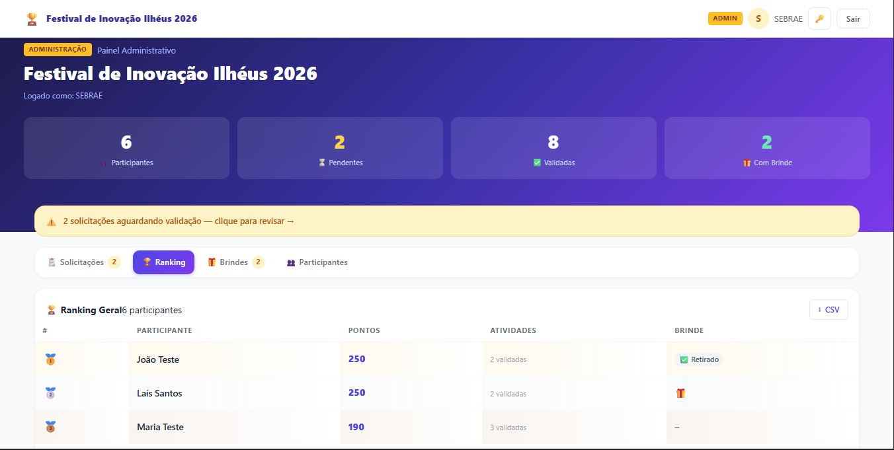
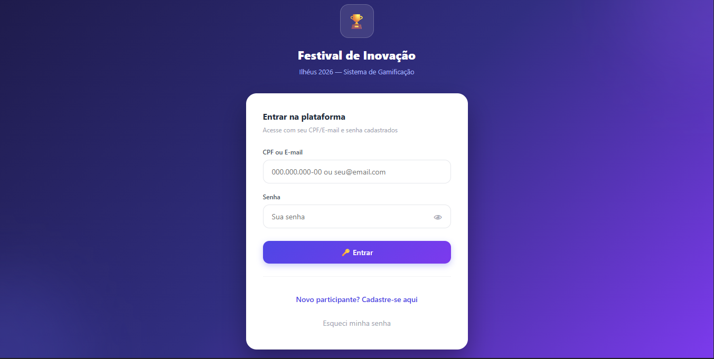
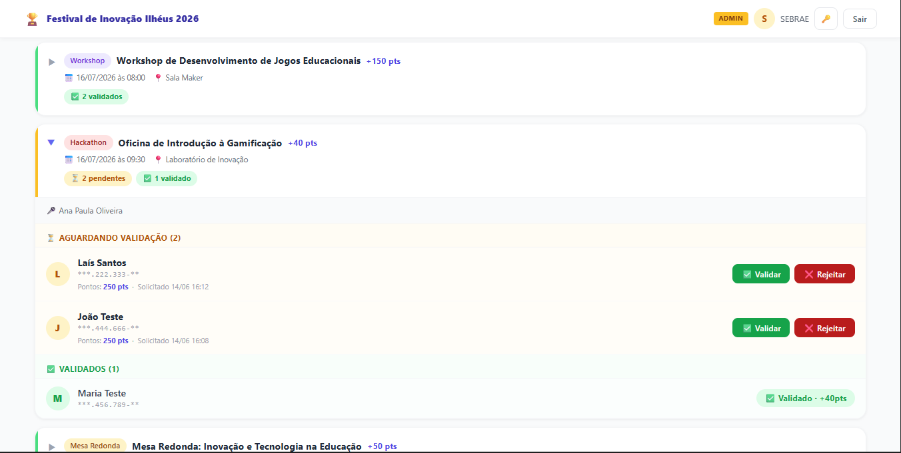
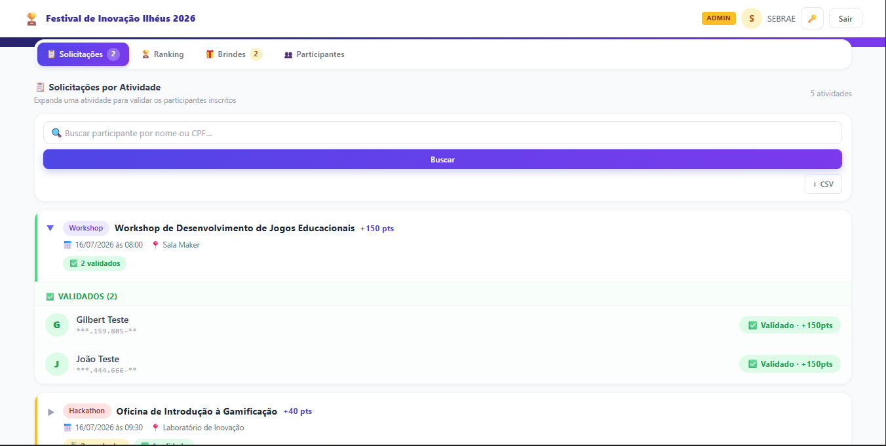
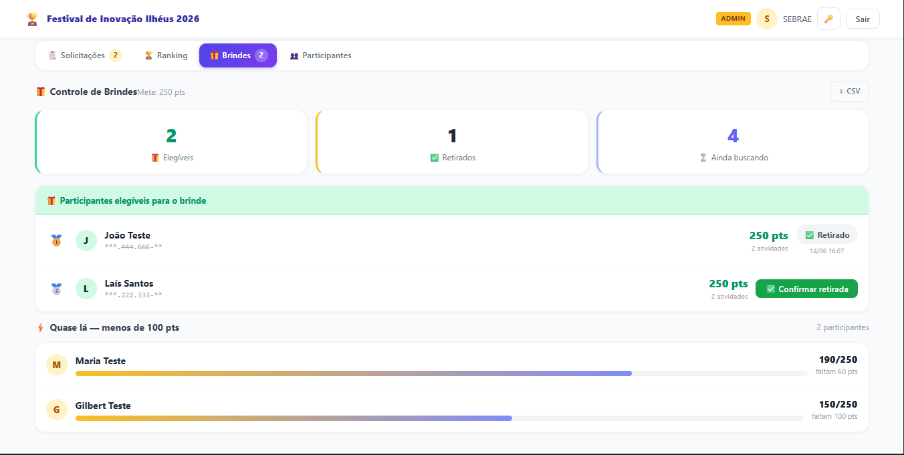

# 🏆 Sistema de Gamificação — Festival de Inovação Ilhéus 2026

> Plataforma web que transforma a participação nas atividades do festival em pontos, ranking e brindes, com um painel para a equipe do SEBRAE validar tudo no balcão do evento.



**Cliente:** SEBRAE Bahia · **Contexto:** desafio tecnológico da Residência Conecta e Capacita (CEPEDI/IFBA — Bolsa Futuro Digital) · **Meu papel:** líder técnico e desenvolvedor back-end

> 🔒 **O código-fonte é privado**, porque pertence ao cliente. Este repositório apresenta o projeto. Posso fazer uma demonstração técnica em entrevista.

---

## 🎯 O problema

O festival precisava incentivar os visitantes a participar do maior número possível de atividades (workshops, palestras, hackathons e mesas-redondas) e recompensar quem se engajasse. A participação precisava ser comprovada presencialmente, e a organização precisava acompanhar tudo em tempo real.

## 💡 A solução

```
Participante se cadastra
        ↓
Solicita participação em uma atividade
        ↓
Equipe SEBRAE valida no balcão  ← painel administrativo
        ↓
Participante ganha pontos e sobe no ranking
        ↓
Atinge a meta → retira o brinde (baixa registrada no painel)
```

## ✨ Funcionalidades

**Para o participante**
- Cadastro e login com CPF ou e-mail, com validação de CPF/CNPJ
- Solicitação de participação nas atividades
- Pontuação, posição no ranking e progresso até o brinde
- Interface responsiva, pensada para o celular

**Para a organização (painel administrativo)**
- Atividades agrupadas em cards expansíveis, com validação ou rejeição em um clique
- Ranking geral com indicadores do evento (participantes, pendentes, validadas e brindes)
- Controle de entrega de brindes por meta de pontos, com a seção "quase lá"
- Busca por nome ou CPF, com CPF sempre exibido mascarado
- Exportação em CSV (UTF-8 com BOM e separador `;`, que abre direto no Excel brasileiro)
- Interface preparada para mais de 8 mil participantes

**Segurança e operação**
- Bloqueio de conta após 5 tentativas de login erradas
- Recuperação de senha por e-mail
- Registro de auditoria das ações administrativas
- Papéis separados: participante, administrador SEBRAE e superusuário técnico
- Documentação de operação, FAQ e conformidade com a LGPD

## 🛠️ Stack

| Camada | Tecnologia |
|---|---|
| Back-end | Python · Django |
| Front-end | Templates Django · HTML · CSS |
| Autenticação | Sessões do Django · django-axes (bloqueio por tentativas) |
| Banco de dados | MySQL |
| Deploy | Railway |

## 📸 Telas

| Login | Validação de participações |
|---|---|
|  |  |

| Solicitações por atividade | Controle de brindes |
|---|---|
|  |  |

*Todas as telas usam dados fictícios de teste.*

## 🧭 Como o projeto foi conduzido

- **Evolução do protótipo:** o projeto começou como um protótipo e foi refeito do zero em Django, para ter persistência real, autenticação e um painel administrativo
- **Trabalho com o cliente:** conduzi as reuniões, mantive contato direto com o SEBRAE e refinei o sistema a partir do feedback dele
- **Entrega:** o sistema foi colocado no ar com apoio da equipe de TI (UTIC) do SEBRAE e aprovado pela equipe do cliente
- **Documentação:** escrevi o Manual do Administrador, voltado aos operadores do balcão do evento

## 📚 O que aprendi

Neste desáfio para minha carreira como desenvolvedor back-end com python e django, aprendi durante todo o processo diversas competências: habilidades na programação e aprofundamento no conhecimento teórico e técnico, experiência em lidar como líder tecnico do projeto, na condução de reuniões com os clientes, lidar com prazos e com imprevistos sob pressão.

---

**Gilbert C. Macêdo** · Desenvolvedor Back-end Python | Django
[LinkedIn](#) · [Portfólio](#) · gilbertcm139@gmail.com
